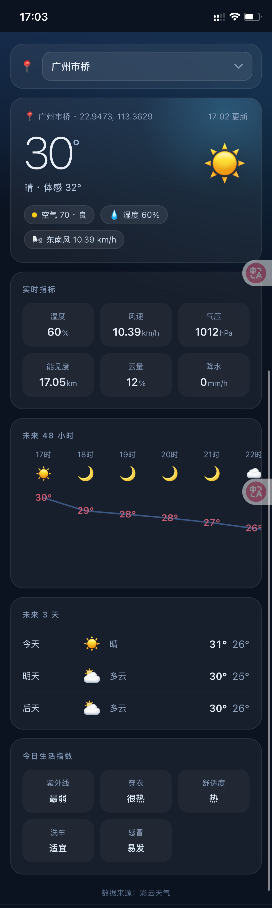

# ☀️ 自用彩云天气网页版（Cloudflare Worker）

一个把**彩云天气**接口包装成可直接访问网页的 Cloudflare Worker：首页实时天气、未来 24 小时 / 多天预报、城市切换，另提供 `/api/cities`、`/api/weather` 两个接口，前端与后端全部内嵌在单个 Worker 中。

（只能看自己添加上去的城市、经纬度地点）



> [!CAUTION]
> **请勿把 `CITIES`、`CAIYUN_TOKEN` 等环境变量明文写进仓库。** 它们应在 Cloudflare 控制台配置（Settings → Variables and Secrets），代码仓库中只保留引用说明。

> [!WARNING]
> **环境变量不随 Git 提交。** 通过 Git 连接部署成功后，需在 Worker 的 Settings 里重新添加一遍 `CITIES`（或 `city / city1 / city2…`）和 `CAIYUN_TOKEN` 并重新部署，否则城市列表为空、天气接口不可用。

## ✨ 功能特点

1. **首页天气面板：** 实时温度、体感、湿度、风速、气压、能见度、云量、降水、空气质量，一目了然；
2. **未来 24 小时曲线：** 逐小时温度趋势 + 图标 + 降水概率；
3. **未来多天预报：** 逐日最高 / 最低温、天气与生活指数；
4. **多城市切换：** 顶部下拉框选择城市，所选城市自动保存（localStorage）；
5. **城市配置灵活：** 既支持 JSON 数组，也支持 `city / city1 / city2…` 单个变量逐个添加（见「变量说明」）。

## 🔧 依赖

- 一个 **Cloudflare** 账号；
- 一个 **GitHub** 账号（用于 Fork 本项目）；
- 一个 **彩云天气** Token（必填，配置为 `CAIYUN_TOKEN`）。

## 🚀 Workers 部署方法（推荐 · Git 集成）

<details>
<summary><code><strong>「 Workers + Git 部署文字教程 」</strong></code></summary>


### 1. 部署 Cloudflare Worker（Git 集成）：

   - 在 GitHub 上先 **Fork 本项目**，并点上 **Star** !!!
   - 打开 Cloudflare 控制台 → **Workers & Pages** → **创建 Worker** → 选择 **连接到 Git**；
   - 选中本项目（已 Fork 的仓库）后点击 **开始设置**，Cloudflare 会自动识别 `wrangler.toml`（内含 `name = "weather"` 与 `main = "worker.js"`）；
   - 点击 **保存并部署**，此后该仓库每次 push 都会自动构建并部署。

### 2. 配置环境变量：

   - 进入该 Worker → **Settings → Variables and Secrets** → 添加「变量说明」中的变量；
   - 重新部署（或等待自动部署），即可访问 `https://weather.<账号名>.workers.dev`。

### 3. （可选）绑定自定义域：

   - 在 Worker 的 **Settings → Domains & Routes** → **添加自定义域**，填入子域名（例如 `weather.example.com`），并按提示在 DNS 处添加 CNAME 指向 `weather.<账号名>.workers.dev`。

</details>

## 📦 Pages 部署方法（备选 · 高级模式）

<details>
<summary><code><strong>「 Pages + Git 部署文字教程 」</strong></code></summary>


> [!NOTE]
> 此方案将文件命名为 **`_worker.js`** 放在 Pages 项目构建输出目录，Pages 会将其当作完整 Worker 运行。仅在坚持使用 Pages 时采用。

### 1. 部署 Cloudflare Pages（高级模式）：

   - 在 GitHub 上先 **Fork 本项目**，并点上 **Star** !!!
   - Fork 后，在 GitHub 网页上将仓库根目录的 `worker.js` **重命名为 `_worker.js`**（Pages 高级模式要求的文件名）；
   - 在 Cloudflare Pages 控制台中选择 **创建项目 → 连接到 Git**，选中本项目（已 Fork 的仓库）后点击 **开始设置**；
   - 构建配置留空（无需构建命令），输出目录填 **`/`**；
   - 部署后得到 `https://<项目名>.pages.dev`。

### 2. 配置环境变量：

   - 项目 → **Settings → Environment variables** → 添加「变量说明」中的变量，重新部署。

</details>

## 📋 变量说明

| 变量名                   | 示例                                                         | 必填 | 备注                                                         |
| ------------------------ | ------------------------------------------------------------ | ---- | ------------------------------------------------------------ |
| CITIES                   | `[{"name":"北京","lng":116.4074,"lat":39.9042},{"name":"深圳","lng":114.0579,"lat":22.5431}]` | ❌    | 方式 A：用一个 JSON 数组装全部城市；<br>与 `city / city1 / …` 同时存在时，**此变量优先** |
| city / city1 / city2 / … | 值一：`北京,116.4074,39.9042`<br>值二：`116.4074,39.9042`    | ❌    | 方式 B：**一个变量一个城市**，有几个城市就建几个变量；<br>分隔符支持 `, , ， ; ；、 \|` 或空格；<br>值只有 `经度,纬度` 时，**用变量名当城市名**（如 `city1`） |
| CAIYUN_TOKEN             | `XXXXXXXXXXXXXXXX`（示例，勿用真值）                         | ✅    | 彩云天气 Token（**必填**）；未配置时 `/api/weather` 会直接返回「未配置 CAIYUN_TOKEN」的错误提示 |

> **CITIES 两种写法示例**
>
> 方式 A（一个变量装多个城市，推荐）：
>
> ```
> CITIES = [{"name":"北京","lng":116.4074,"lat":39.9042},{"name":"深圳","lng":114.0579,"lat":22.5431}]
> ```
>
> 方式 B（一城一变量，需加城市就新增一个变量）：
>
> ```
> city1 = 北京,116.4074,39.9042
> city2 = 深圳,114.0579,22.5431
> ```
>
> 或只写坐标、用变量名当城市名：
>
> ```
> city1 = 116.4074,39.9042
> city2 = 114.0579,22.5431
> ```

## ⚠️ 注意事项

1. **环境变量不进仓库**：`CITIES`、`CAIYUN_TOKEN` 在 Cloudflare 控制台配置，提交中只包含 `worker.js` 与 `wrangler.toml`；
2. **环境变量需重新配置**：每次更换新的 Worker / Pages 项目，都要重新添加一遍变量；
3. **方式 B 城市名**：值里带城市名（`北京,116.4074,39.9042`）时用值里的名；值只有坐标（`116.4074,39.9042`）时用变量名（`city1`）；
4. **Pages 与 Workers 二选一**：使用 Pages 高级模式时文件须命名为 `_worker.js`，且不能同时存在 `functions/` 目录；
5. **彩云 Token**（`CAIYUN_TOKEN`）：**必填**，请在控制台以 Secret 方式配置；本仓库已删除代码内置默认值，请勿把真实 Token 写进任何提交，以免被他人消耗额度。

## 🙏 声明

本项目仅供个人学习与日常使用。彩云天气为第三方服务，其接口与计费规则以官方为准，请遵守其服务条款。本项目与彩云天气官方无关联。
